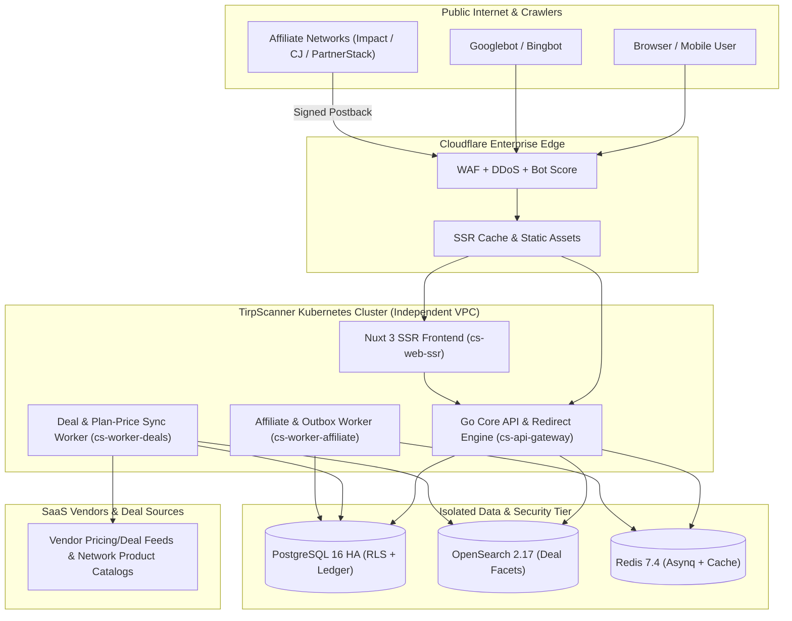
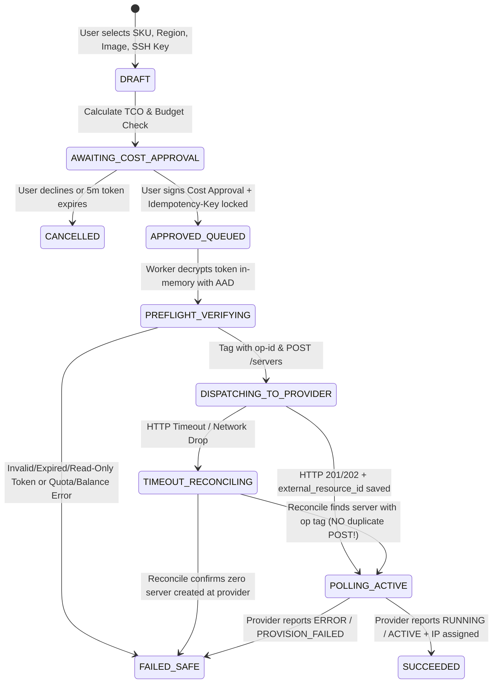

# SYSTEM_DIAGRAMS.md — TirpScanner Architecture & State Machine Diagrams

**Document ID:** `CS-ARCH-002`

> **Pivot addendum (2026-11-26):** Diagrams refreshed for TirpScanner. The BYOC worker and cloud management APIs are removed, while KMS envelope encryption now protects affiliate/integration credentials; the live platform ingests SaaS/AI-tool deals and monetizes via affiliate. The BYOC provisioning state machine is preserved below as retired history.

---

## 1. End-to-End Platform Architecture Diagram

---

## 2. Deal Scan & Price-Drop Detection Flow (live)

```mermaid
stateDiagram-v2
    [*] --> FETCHING: Scheduled ingestion run starts
    FETCHING --> HASH_COMPARING: Raw feed payload archived + SHA-256 hashed
    HASH_COMPARING --> VERIFIED_CURRENT: Payload unchanged — bump verified_at
    HASH_COMPARING --> ANOMALY_CHECKING: Payload changed
    ANOMALY_CHECKING --> QUARANTINED: Price swing > 25% or plan count drop > 20%
    QUARANTINED --> ANOMALY_CHECKING: Admin approves or rejects with reason
    ANOMALY_CHECKING --> NORMALIZED: Snapshot validated & plan prices normalized
    NORMALIZED --> PRICE_DROP_MATCHING: Immutable price_snapshot inserted
    PRICE_DROP_MATCHING --> ALERTS_DISPATCHED: Drops matched to price_alerts; notifications sent
    PRICE_DROP_MATCHING --> INDEXED: No drops — OpenSearch deal index updated
    ALERTS_DISPATCHED --> INDEXED: OpenSearch deal index updated
    VERIFIED_CURRENT --> [*]
    INDEXED --> [*]
```

---

## 3. BYOC Safe Server Provisioning State Machine — RETIRED HISTORY (do not implement)

> Retired 2026-11-26 with the TirpScanner pivot. Preserved for audit traceability only.

