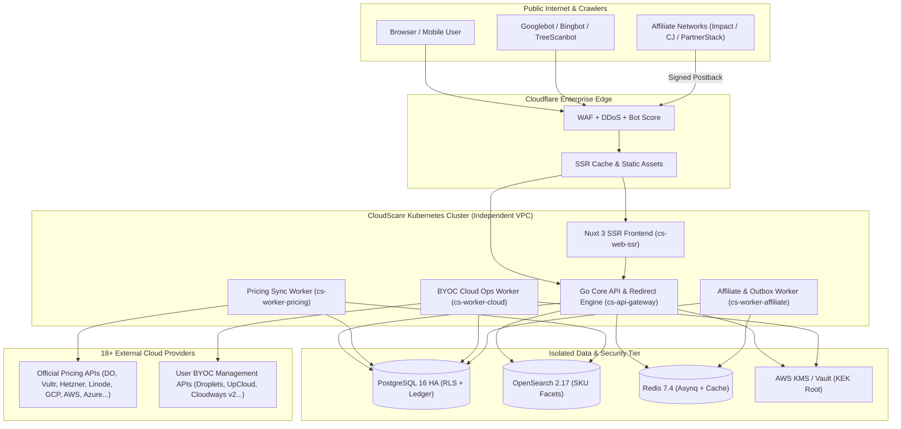
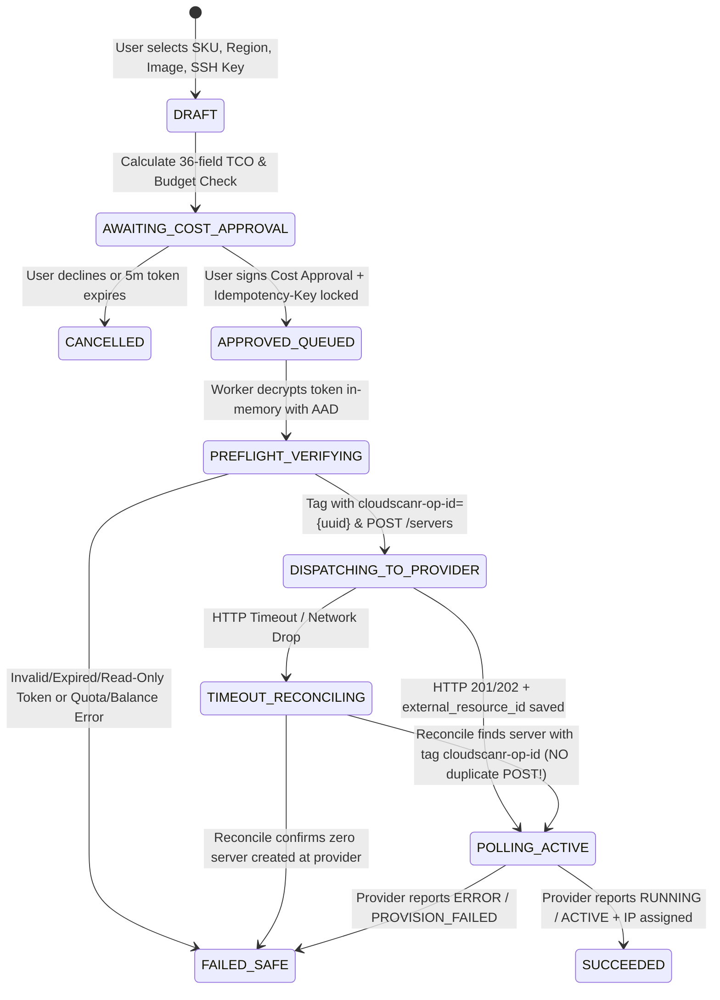

# SYSTEM_DIAGRAMS.md — CloudScanr Architecture & State Machine Diagrams

**Document ID:** `CS-ARCH-002`

---

## 1. End-to-End Platform Architecture Diagram

---

## 2. BYOC Safe Server Provisioning & Timeout Reconciliation State Machine (Article 13 & 24)

