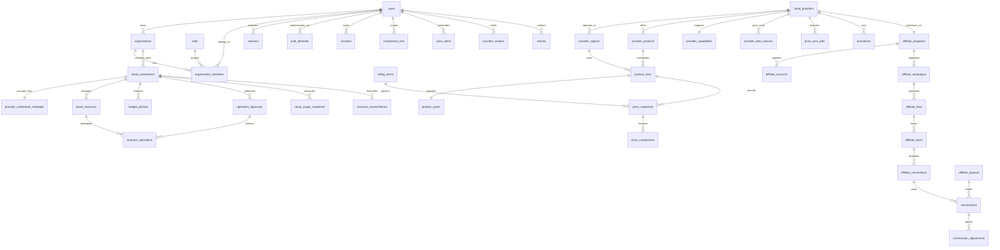

# ERD.md — CloudScanr PostgreSQL 16 Entity-Relationship Diagram (49 Tables Across 7 Domains)

**Document ID:** `CS-DB-001`  
**Database Engine:** PostgreSQL 16 (Dedicated Instance — Zero TreeScan Dependency)

---

## 1. Domain Entity-Relationship Diagram (Mermaid)

---

## 2. Domain Table Count & Compliance Summary (Article 18)

| Domain | Required Tables (Article 18) | Implemented SQL Migration | Total Tables |
| :--- | :--- | :--- | :--- |
| **1. Identity** | `users`, `organizations`, `organization_members`, `roles`, `sessions`, `auth_identities` | `000002_identity_domain.up.sql` | **6** |
| **2. Providers** | `cloud_providers`, `provider_regions`, `provider_products`, `provider_capabilities`, `provider_data_sources` | `000003_providers_domain.up.sql` | **5** |
| **3. Pricing** | `product_skus`, `product_specs`, `price_snapshots`, `price_components`, `billing_terms`, `promotions`, `fx_rates`, `tax_policies`, `price_sync_jobs` | `000004_pricing_domain.up.sql` | **9** |
| **4. Affiliate** | `affiliate_programs`, `affiliate_accounts`, `affiliate_campaigns`, `affiliate_links`, `affiliate_clicks`, `affiliate_conversions`, `commissions`, `commission_adjustments`, `affiliate_payouts` | `000005_affiliate_domain.up.sql` | **9** |
| **5. Cloud Management** | `cloud_connections`, `provider_credentials_metadata`, `cloud_resources`, `resource_operations`, `operation_approvals`, `cloud_usage_snapshots`, `budget_policies`, `resource_reconciliations` | `000006_cloud_management_domain.up.sql` | **8** |
| **6. Search & Content** | `search_events`, `comparison_lists`, `favorites`, `price_alerts`, `articles`, `provider_reviews` | `000007_search_and_content_domain.up.sql` | **6** |
| **7. Operations** | `audit_logs`, `background_jobs`, `outbox_events`, `admin_actions`, `feature_flags`, `system_settings` | `000008_operations_domain.up.sql` | **6** |
| **Total** | **All 49 Mandatory Domain Tables + 1 Materialized View (`mv_daily_affiliate_yield`)** | `000001` ~ `000012` | **49 Tables + 1 MV** |
