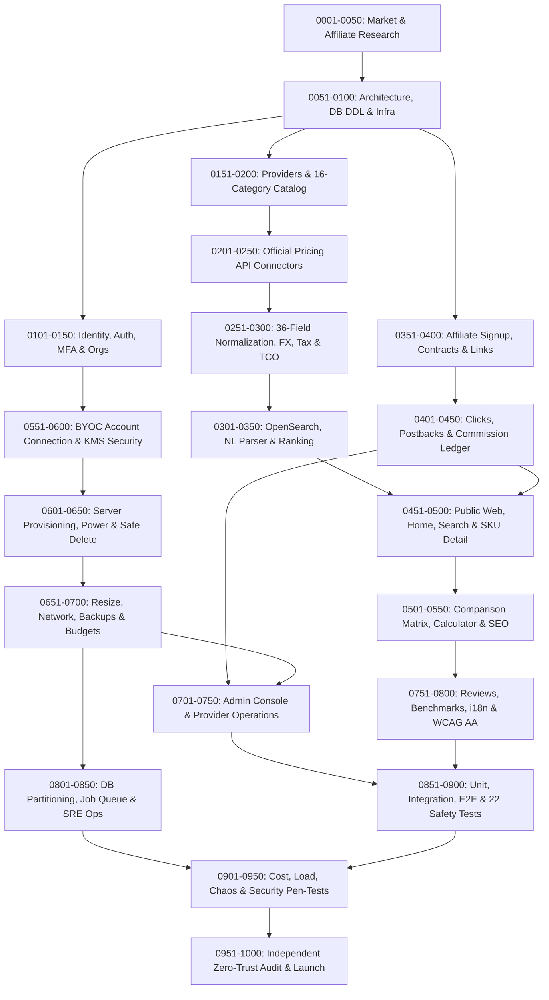

# DEPENDENCY_GRAPH.md — 1,000 Work Order Directed Acyclic Graph (DAG) & Critical Path

**Document ID:** `CS-WO-DAG`

---

## 1. Macro Dependency DAG Across the 20 Work Order Bands

## 2. Critical Path Lock Gates
1. **Lock Gate 1 (`WO-CS-0071`)**: All 12 PostgreSQL DDL migrations (`49 tables`) must be applied before domain repositories (`0101+`) execute.
2. **Lock Gate 2 (`WO-CS-0551`)**: KMS Envelope Encryption with `org_id:connection_id:provider_id` AAD must pass `SEC-02` before any BYOC token (`0565+`) or server provisioning (`0601+`) is enabled.
3. **Lock Gate 3 (`WO-CS-0601` & `WO-CS-0615`)**: Explicit Cost Approval (`operation_approvals`) and Timeout Reconciliation (`TIMEOUT_RECONCILING`) must pass all 22 Article 24 safety tests (`0881–0902`) before live BYOC provisioning is unlocked.
